# Interface Control Document (ICD): Companion Protocol & Inter-Core IPC

**Project:** Schlagzähler – Piezo-based Hit Detection and Interactive Game System  
**Document Version:** 2.1.0  
**Target Hardware:** Raspberry Pi Pico W (`pico_w`, RP2040, dual-core ARM Cortex-M0+)  
**Companion Client:** Schlagzähler Web Dashboard (Angular v22, W3C Web Serial API) & Serial Terminals  
**Related Source Files:**
- Firmware:
  - [`src/Common/Messages.h`](../schlagzaehler-pico/src/Common/Messages.h)
  - [`src/Common/GameTypes.h`](../schlagzaehler-pico/src/Common/GameTypes.h)
  - [`src/Common/Events.h`](../schlagzaehler-pico/src/Common/Events.h)
  - [`src/App/Companion/CompanionProtocol.h`](../schlagzaehler-pico/src/App/Companion/CompanionProtocol.h)
  - [`src/App/Companion/CommandHandler.h`](../schlagzaehler-pico/src/App/Companion/CommandHandler.h)
- Web Application:
  - [`companion-protocol.ts`](../schlagzaehler-web/src/app/core/device/protocol/companion-protocol.ts)
  - [`device.model.ts`](../schlagzaehler-web/src/app/core/device/models/device.model.ts)
  - [`web-serial-transport.ts`](../schlagzaehler-web/src/app/core/device/transport/web-serial-transport.ts)

---

## 1. System Overview & Dual-Core Architecture

The Schlagzähler system employs a strictly decoupled dual-core RP2040 architecture:
- **Core 0 (Real-Time Sensing & Authoritative Game Logic)**: Executes continuous 150 kHz aggregate (3x 50 kHz round-robin) ADC DMA sampling, peak detection, coincidence-window hit classification, and game state management (`COUNT`, `TIMED`, `RACE`). Core 0 never performs blocking serial or display I/O.
- **Core 1 (Display & Asynchronous I/O)**: Drives the ST7735 128x160 SPI TFT display and manages bidirectional USB CDC Serial communication with the companion software. Core 1 polls incoming serial bytes, decodes command frames, pushes IPC messages to Core 0, and drains outbound telemetry events.

```
┌────────────────────────────────────────────────────────────────────────┐
│                    Schlagzähler Companion Web Client                   │
│                       (Angular v22 / Web Serial)                       │
└───────────────────────────────────▲────────────────────────────────────┘
                                    │ USB CDC Serial (115200 baud)
                                    │ Dual-Mode: Framed Binary (TLV) / ASCII
                                    ▼
┌────────────────────────────────────────────────────────────────────────┐
│                    RP2040 Core 1 (Display & I/O)                       │
│  - UsbSerialDriver (stdio_usb)                                         │
│  - CompanionProtocol dual-mode parser & chunked streaming engine       │
│  - CommandHandler                                                      │
│  - DisplayPresenter (ST7735 128x160 SPI TFT)                           │
└───────────────────────▲────────────────────────┬───────────────────────┘
                        │                        │
          queue_core0_to_core1 (Cap: 16)         │ queue_core1_to_core0 (Cap: 8)
          Core0ToCore1Message                    │ Core1ToCore0Message
          (State, Hits, Timer, Telemetry)        │ (Commands: Start, Mode, Calib...)
                        │                        │
┌───────────────────────┴────────────────────────▼───────────────────────┐
│              RP2040 Core 0 (Real-Time Sensing & Logic)                 │
│  - 3x 50 kHz ADC DMA ping-pong buffers (GPIO 26, 27, 28)               │
│  - HitDetector (Exponential decay baseline & dynamic thresholds)       │
│  - Authoritative GameController & Mode State Machines                  │
│  - ButtonController (Debouncing & physical UI)                         │
└────────────────────────────────────────────────────────────────────────┘
```

---

## 2. Session Lifecycle, Late Connections & Multi-Client Switching

Because the companion is typically a browser-based Single Page Application (SPA), the following connection scenarios are handled deterministically:

1. **Late Connection**: The Pico boots and runs standalone (e.g. user plays via hardware buttons and TFT display). A web companion connects minutes or hours later.
2. **Page Reload or Reconnection**: The user refreshes the browser, closes/reopens the tab, or reconnects the USB cable.
3. **Different Web Client Connecting**: A developer opens the serial port with a terminal (ASCII), or a different device/computer attaches to the USB port.
4. **Orphaned Capture Recovery**: A client disconnects while a high-frequency waveform capture is being streamed over serial.

### 2.1 Connection Handshake Flow

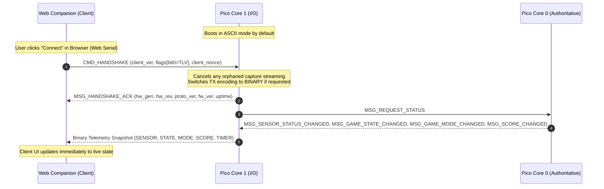

### 2.2 Client Switching & Reconnect Rules

- **Client-Driven Negotiation**: Handshakes are initiated by the connecting client via `CMD_HANDSHAKE` (binary) or `STATUS` (ASCII). The Pico does not depend on USB DTR pin assertions.
- **State Reset on New Handshake**: When `CMD_HANDSHAKE` is received:
  - If a raw capture transfer was in progress, it is immediately aborted (`CompanionProtocol_cancel_capture_tx`).
  - Active encoding mode is updated to the client's requested encoding (`BINARY` or `ASCII` based on Flag bit 0).
  - Core 1 immediately emits `MSG_HANDSHAKE_ACK` followed by a complete state synchronization burst (`SENSOR_STATUS`, `GAME_STATE`, `GAME_MODE`, `SCORE`, `TIMER`).
- **Graceful Fallback**: If a client sends printable ASCII commands (`START`, `STATUS`, `RESET`, `CALIB`), Core 1 processes them via the ASCII parser and replies with ASCII lines.

---

## 3. Wire Protocol Architecture (Dual-Mode)

### 3.1 Transport Layer Details
- **Medium**: USB CDC Virtual COM Port (ACM).
- **Default Baud Rate**: `115200` baud.
- **Endianness**: Little-Endian for all multi-byte binary numbers (`uint16_t`, `uint32_t`, `float`).

### 3.2 Dual-Mode RX Discrimination

Core 1 continuously reads bytes from `UsbSerialDriver`. It discriminates between Binary and ASCII packets based on the leading byte:
- **Binary Frame**: Starts with Sync Word `0xAA55` (first byte received is `0x55`, second is `0xAA` in little-endian).
- **ASCII Line**: Starts with printable characters (`'A' - 'Z'`, e.g., `START`, `RESET`, `CALIB`, `MODE`, `PARAM`, `SENS`, `STATUS`, `CAPTURE`). Buffers until `\n`.

---

## 4. Binary Protocol Specification (Framed TLV)

Every binary message consists of a **Common Frame Header**, a **Variable-Length Payload**, and a **CRC-16 Frame Check Sequence**:

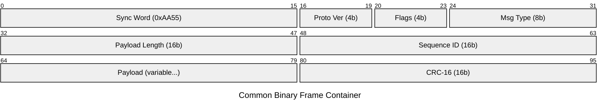

- **Sync Word (`uint16_t`, 16 bits)**: Always `0xAA55` (transmitted as `0x55, 0xAA` in little-endian).
- **Protocol Version (`4 bits`)**: Major wire protocol version (currently `1`).
- **Flags (`4 bits`)**:
  - `Bit 0`: `IS_ERROR` (Indicates error/rejection)
  - `Bits 1-3`: Reserved (must be `0`)
- **Message Type (`uint8_t`, 8 bits)**: Unique message identifier (`0x01`–`0x7F` for Commands, `0x80`–`0xFF` for Telemetry).
- **Payload Length (`uint16_t`, 16 bits)**: Size of the payload following the header in bytes (`0` to `65535`).
- **Sequence ID (`uint16_t`, 16 bits)**: Monotonically increasing packet counter for sequence validation and loss detection.
- **Payload (`0 to N bytes`)**: Message-specific payload data (defined in Sections 5 and 6).
- **CRC-16 (`uint16_t`, 16 bits)**: Appended immediately after payload. Computed over the frame header and payload using CRC-16-CCITT (polynomial `0x1021`, initial value `0xFFFF`).

---

## 5. Command Payloads (Web Companion $\rightarrow$ Pico W)

Message IDs `0x01` to `0x7F`.

### 5.1 `CMD_HANDSHAKE` (`0x01`)
Sent by the web client immediately upon opening the serial port to establish protocol version, select encoding, and register its session. Resetting in-flight captures and emitting a full state snapshot are default behaviors upon receiving a handshake.

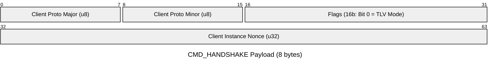

| Field | Type | Description |
| --- | --- | --- |
| `client_proto_major` | `uint8_t` | Client's supported major protocol version (e.g. `1`). |
| `client_proto_minor` | `uint8_t` | Client's supported minor protocol version (e.g. `0`). |
| `flags` | `uint16_t` | Bit 0: `TLV_MODE` (`0` = ASCII output, `1` = Binary TLV output). Bits 1–15: Reserved (must be `0`). |
| `client_nonce` | `uint32_t` | Random non-zero identifier generated by the web client to distinguish sessions and reloads. |

---

### 5.2 `CMD_START` (`0x02`)
Starts or restarts the active game from `READY`, `MENU`, or `FINISHED` state.
- **Payload Length**: `0` bytes (Header + CRC only).

---

### 5.3 `CMD_RESET` (`0x03`)
Cancels active gameplay and ongoing raw signal capture, resets score to 0, and returns game to `READY`.
- **Payload Length**: `0` bytes (Header + CRC only).

---

### 5.4 `CMD_CALIBRATE` (`0x04`)
Triggers baseline and noise evaluation across all sensors (1,500 ms sampling period).
- **Payload Length**: `0` bytes (Header + CRC only).

---

### 5.5 `CMD_STATUS` (`0x05`)
Requests an immediate full telemetry broadcast from Core 0 (`SENSOR_STATUS`, `GAME_STATE`, `GAME_MODE`, `SCORE`, `TIMER`).
- **Payload Length**: `0` bytes (Header + CRC only).

---

### 5.6 `CMD_SET_MODE` (`0x06`)
Switches the active game mode. Valid in `MENU` or `READY` states.


| Field | Type | Description |
| --- | --- | --- |
| `mode` | `uint8_t` | `0` = `GAME_MODE_COUNT`, `1` = `GAME_MODE_TIMED`, `2` = `GAME_MODE_RACE`. |

---

### 5.7 `CMD_SET_PARAMETER` (`0x07`)
Sets the duration (seconds for `TIMED` mode) or target hit count (for `RACE` mode).

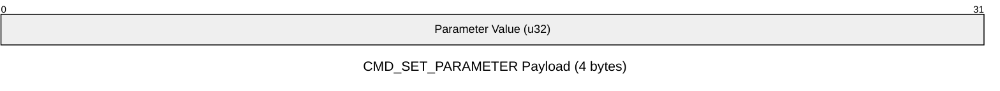

| Field | Type | Description |
| --- | --- | --- |
| `parameter` | `uint32_t` | Seconds (`5` to `300`) or target hits (`5` to `500`). |

---

### 5.8 `CMD_SET_SENSITIVITY` (`0x08`)
Adjusts the dynamic noise factor threshold multiplier in `HitDetector`.

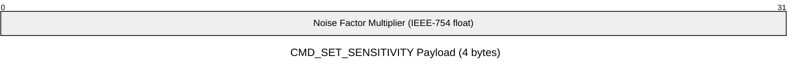

| Field | Type | Description |
| --- | --- | --- |
| `noise_factor` | `float` | Multiplier applied to baseline noise (clamped between `1.0` and `20.0`). |

---

### 5.9 `CMD_CAPTURE` (`0x09`)
Arms or cancels raw high-frequency piezo signal capture.


| Field | Type | Description |
| --- | --- | --- |
| `action` | `uint8_t` | `0` = `STOP` / cancel capture, `1` = `START` / arm capture. |
| `target_sensor` | `uint8_t` | `0`, `1`, `2` for a single channel, or `3` for `ALL` channels. |

---

## 6. Telemetry & Event Payloads (Pico W $\rightarrow$ Web Companion)

Message IDs `0x80` to `0xFF`.

### 6.1 `MSG_HANDSHAKE_ACK` (`0x81`)
Response to `CMD_HANDSHAKE`. Informs client of hardware platform, firmware and protocol versions, and device uptime.

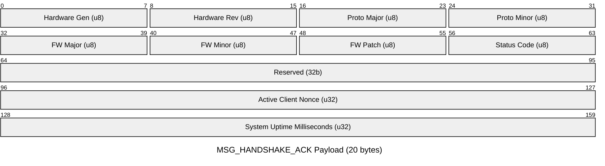

| Field | Type | Description |
| --- | --- | --- |
| `hardware_gen` | `uint8_t` | Hardware generation (`1`). |
| `hardware_rev` | `uint8_t` | Hardware revision (`1`). |
| `proto_major` | `uint8_t` | Wire protocol major version (`1`). |
| `proto_minor` | `uint8_t` | Wire protocol minor version (`0`). |
| `fw_major` / `minor` / `patch` | `uint8_t` | Firmware build version (e.g. `1.2.0`). |
| `status_code` | `uint8_t` | `0` = `OK`, `1` = `ERR_VERSION_MISMATCH`, `2` = `ERR_BUSY`. |
| `reserved` | `uint32_t` | Reserved for future capabilities (set to `0`). |
| `client_nonce` | `uint32_t` | Echoes `client_nonce` from `CMD_HANDSHAKE`. |
| `uptime_ms` | `uint32_t` | Hardware uptime in milliseconds since boot. |

---

### 6.2 `MSG_SENSOR_STATUS` (`0x82`)
Broadcast when the sensor front-end transitions states.


| Field | Type | Description |
| --- | --- | --- |
| `state` | `uint8_t` | `0` = `INIT`, `1` = `CALIBRATING`, `2` = `ARMED`, `3` = `LOCKOUT`, `4` = `CAPTURE_ARMED`, `5` = `CAPTURING`, `6` = `CAPTURE_TX_WAIT`, `7` = `ERROR`. |
| `target` | `uint8_t` | `0`, `1`, `2` for a single channel; `3` for `ALL`. |

---

### 6.3 `MSG_CALIBRATION_RESULT` (`0x83`)
Emitted after completion of the 1,500 ms baseline and noise evaluation for a sensor, and re-emitted immediately before `MSG_CAPTURE_START` with the `REPEATED` flag set.

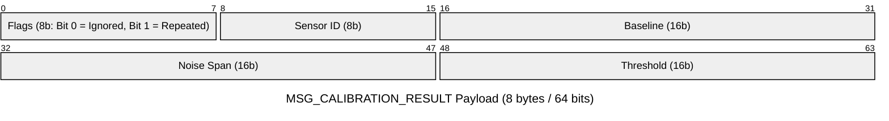

| Field | Bits | Type | Description |
| --- | --- | --- | --- |
| `flags` | 8 | `uint8_t` | Bit 0: `IGNORED` (`1` = sensor disabled due to low baseline / high noise; `0` = active).<br>Bit 1: `REPEATED` (`1` = re-sent prior to capture streaming; `0` = fresh calibration result).<br>Bits 2–7: Reserved (`0`). Success is implied when emitted. |
| `sensor_id` | 8 | `uint8_t` | Sensor channel index (`0`, `1`, `2`). |
| `baseline` | 16 | `uint16_t` | Evaluated DC offset baseline in ADC counts (`0`–`4095`). |
| `noise_span` | 16 | `uint16_t` | Peak-to-peak ambient noise band in ADC counts. |
| `threshold` | 16 | `uint16_t` | Calculated dynamic trigger threshold for hit detection. |

---

### 6.4 `MSG_HIT_DETECTED` (`0x84`)
Emitted in real-time when Core 0's coincidence window detects a valid piezo strike.

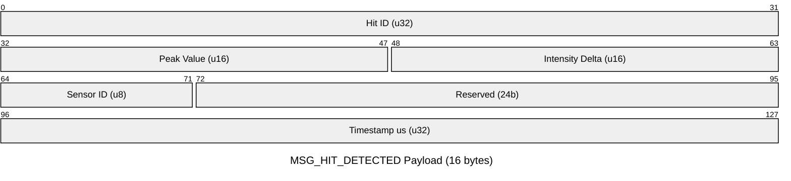

| Field | Type | Description |
| --- | --- | --- |
| `hit_id` | `uint32_t` | Monotonically increasing hit counter since boot. |
| `peak_value` | `uint16_t` | Maximum 12-bit ADC count reached during the strike. |
| `intensity` | `uint16_t` | Net signal delta above baseline (`peak_value - baseline`). |
| `sensor_id` | `uint8_t` | Channel index that recorded the highest amplitude (`0`, `1`, `2`). |
| `timestamp_us` | `uint32_t` | Core 0 hardware timer microsecond timestamp. |

---

### 6.5 `MSG_GAME_STATE` (`0x85`)
Emitted on authoritative game state machine transitions.


| Field | Type | Description |
| --- | --- | --- |
| `old_state` | `uint8_t` | `0` = `BOOT`, `1` = `MENU`, `2` = `READY`, `3` = `RUNNING`, `4` = `FINISHED`, `5` = `CAPTURING`. |
| `new_state` | `uint8_t` | Same enum mapping as `old_state`. |

---

### 6.6 `MSG_GAME_MODE` (`0x86`)
Emitted when game mode or target parameter is selected.

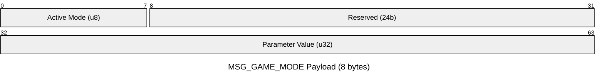

| Field | Type | Description |
| --- | --- | --- |
| `mode` | `uint8_t` | `0` = `COUNT`, `1` = `TIMED`, `2` = `RACE`. |
| `parameter` | `uint32_t` | Duration in seconds (`TIMED`) or target hits (`RACE`). |

---

### 6.7 `MSG_SCORE` (`0x87`)
Emitted when score changes (game start, reset, or hit registration).

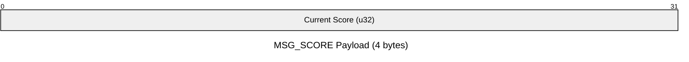

| Field | Type | Description |
| --- | --- | --- |
| `score` | `uint32_t` | Current total hit score. |

---

### 6.8 `MSG_TIMER` (`0x88`)
Emitted periodically (every 100 ms) while game is in `RUNNING` state.

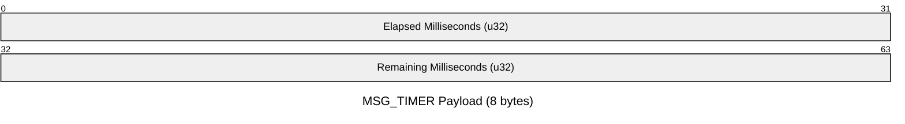

| Field | Type | Description |
| --- | --- | --- |
| `elapsed_ms` | `uint32_t` | Total elapsed active gameplay time in milliseconds. |
| `remaining_ms` | `uint32_t` | Remaining countdown time for `TIMED` mode (`0` for `COUNT` / `RACE`). |

---

### 6.9 `MSG_GAME_FINISHED` (`0x89`)
Emitted upon reaching a game termination condition before entering `FINISHED` state.

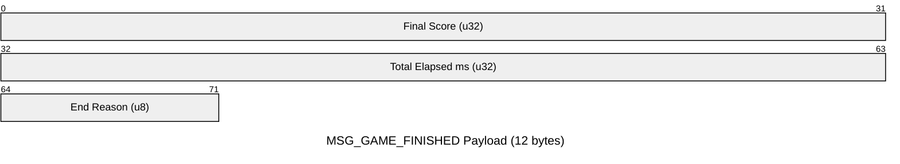

| Field | Type | Description |
| --- | --- | --- |
| `final_score` | `uint32_t` | Final score achieved. |
| `total_time_ms` | `uint32_t` | Total active game duration in milliseconds. |
| `reason` | `uint8_t` | `0` = `NONE`, `1` = `TIME_LIMIT`, `2` = `TARGET_REACHED`, `3` = `ABORTED`. |

---

### 6.10 `MSG_CAPTURE_START` (`0x8A`)
Emitted when a raw waveform buffer has been frozen in SRAM and chunk streaming commences.

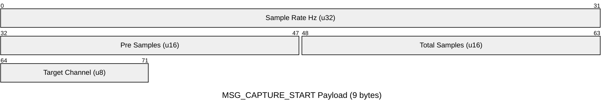

| Field | Type | Description |
| --- | --- | --- |
| `sample_rate_hz` | `uint32_t` | Effective sampling rate in Hz (nominally `10000`). |
| `pre_samples` | `uint16_t` | Pre-trigger sample count (`1000`, corresponding to 100 ms). |
| `total_samples` | `uint16_t` | Total buffer sample count (`21000`, corresponding to 2.1 seconds). |
| `target_channel` | `uint8_t` | Channel index recorded (`0`, `1`, `2`, or `3 = ALL`). |

---

### 6.11 `MSG_CAPTURE_DATA` (`0x8B`)
Streams raw 12-bit ADC samples in binary chunks across Core 1 loop iterations.

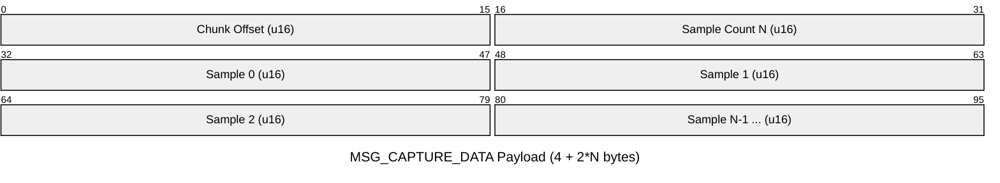

| Field | Type | Description |
| --- | --- | --- |
| `offset` | `uint16_t` | Start index within the 21,000-sample capture buffer. |
| `count` | `uint16_t` | Number of samples in this packet ($N$, typically 64 or 128 samples). |
| `samples` | `uint16_t[N]` | Array of little-endian 16-bit ADC readings (0–4095). |

---

### 6.12 `MSG_CAPTURE_END` (`0x8C`)
Emitted immediately after the final `MSG_CAPTURE_DATA` chunk has been transferred.


| Field | Type | Description |
| --- | --- | --- |
| `total_samples` | `uint16_t` | Verifies total count streamed (e.g. `21000`). |

---

### 6.13 `MSG_ERROR` (`0x8D`)
Emitted on hardware or OSAL faults (e.g. DMA timeout, ADC error).

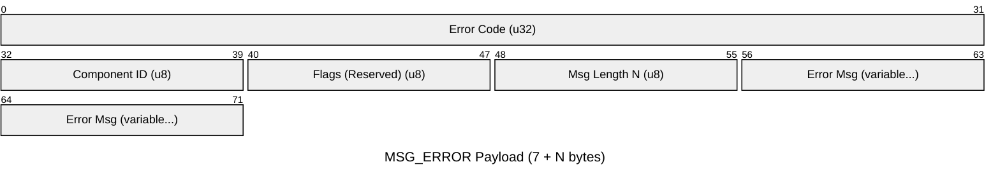

| Field | Type | Description |
| --- | --- | --- |
| `error_code` | `uint32_t` | Numeric subsystem error code. |
| `component_id` | `uint8_t` | `0` = `SYSTEM`, `1` = `ADC`, `2` = `DMA`, `3` = `USB`, `4` = `DISPLAY`. |
| `flags` | `uint8_t` | Reserved (set to `0`). |
| `msg_length` | `uint8_t` | Length of error message string in bytes ($N$). |
| `msg` | `char[msg_length]` | Diagnostic message text (non-null-terminated string of length $N$). |

---

## 7. ASCII Protocol Specification (Side-by-Side Compatibility)

For serial monitor debugging (`minicom`, Arduino Serial Monitor, CLI scripts), the ASCII protocol operates concurrently.

### 7.1 ASCII Commands (Host $\rightarrow$ Pico)
Newline-delimited (`\n` or `\r\n`):

| ASCII Command | Binary Equivalent | Description |
| --- | --- | --- |
| `START` | `CMD_START` | Starts active game. |
| `RESET` | `CMD_RESET` | Resets game and cancels active capture. |
| `CALIB` | `CMD_CALIBRATE` | Triggers sensor baseline calibration. |
| `STATUS` | `CMD_STATUS` | Requests immediate full telemetry broadcast. |
| `MODE:<COUNT\|TIMED\|RACE>` | `CMD_SET_MODE` | Changes active game mode. |
| `PARAM:<u32>` | `CMD_SET_PARAMETER` | Sets mode duration (s) or target hits. |
| `SENS:<float>` | `CMD_SET_SENSITIVITY` | Updates sensor noise multiplier factor. |
| `CAPTURE` or `CAPTURE:START` | `CMD_CAPTURE (1)` | Arms raw waveform capture engine. |
| `CAPTURE:STOP` | `CMD_CAPTURE (0)` | Cancels raw waveform capture engine. |

### 7.2 ASCII Telemetry (Pico $\rightarrow$ Host)

| ASCII Telemetry Line | Binary Equivalent | Example Output |
| --- | --- | --- |
| `BOOT success=<0\|1> msg=<text>` | *(ASCII only)* | `BOOT success=1 msg=Ready` |
| `SENSOR status=<STATUS>` | `MSG_SENSOR_STATUS` | `SENSOR status=ARMED` |
| `CALIB success=<0\|1> target=<u> repeated=<true\|false> ...` | `MSG_CALIBRATION_RESULT` | `CALIB success=1 target=0 repeated=false baseline=1850 noise=12 threshold=1910 ignored=false` |
| `HIT id=<u> target=<u> peak=<u> ...` | `MSG_HIT_DETECTED` | `HIT id=1 target=0 peak=2150 intensity=300` |
| `STATE old=<STATE> new=<STATE>` | `MSG_GAME_STATE` | `STATE old=READY new=RUNNING` |
| `MODE active=<MODE> param=<u>` | `MSG_GAME_MODE` | `MODE active=TIMED param=30` |
| `SCORE value=<u>` | `MSG_SCORE` | `SCORE value=12` |
| `TIMER elapsed=<u> remaining=<u>` | `MSG_TIMER` | `TIMER elapsed=5000 remaining=25000` |
| `RESULT score=<u> time_ms=<u> reason=<s>` | `MSG_GAME_FINISHED` | `RESULT score=42 time_ms=30000 reason=TIME_LIMIT` |
| `CAPTURE_START rate=<u> pre=<u> count=<u> target=<u>` | `MSG_CAPTURE_START` | `CAPTURE_START rate=10000 pre=1000 count=21000 target=3` |
| `CAPTURE_DATA offset=<u> values=...` | `MSG_CAPTURE_DATA` | `CAPTURE_DATA offset=0 values=1850,1852,1849...` |
| `CAPTURE_END count=<u>` | `MSG_CAPTURE_END` | `CAPTURE_END count=21000` |
| `ERROR code=<u> comp=<s> msg=<s>` | `MSG_ERROR` | `ERROR code=1 comp=ADC msg=Timeout` |

---

## 8. Inter-Core IPC Message Reference (`Messages.h`)

Core 0 and Core 1 communicate exclusively via lock-safe OSAL SPSC ring buffers:
- `queue_core0_to_core1` (Capacity: 16 entries)
- `queue_core1_to_core0` (Capacity: 8 entries)

### 8.1 Core 0 $\rightarrow$ Core 1 (`Core0ToCore1Message`)

```c
typedef struct {
    Core0ToCore1MsgType type;
    uint64_t timestamp_us;
    union {
        MsgBootStatus           boot_status;
        MsgCalibrationProgress  calibration_progress;
        MsgCalibrationResult    calibration_result;
        MsgSensorStatusChanged  sensor_status;
        MsgHitDetected          hit;
        MsgGameStateChanged     game_state;
        MsgGameModeChanged      game_mode;
        MsgScoreChanged         score;
        MsgTimerChanged         timer;
        MsgGameFinished         game_finished;
        MsgConfigChanged        config;
        MsgCaptureReady         capture_ready;
        MsgError                error;
    } data;
} Core0ToCore1Message;
```

### 8.2 Core 1 $\rightarrow$ Core 0 (`Core1ToCore0Message`)

```c
typedef struct {
    Core1ToCore0MsgType type;
    uint64_t timestamp_us;
    union {
        MsgSetGameMode      set_mode;
        MsgSetGameParameter set_parameter;
        MsgSetSensitivity   set_sensitivity;
        MsgRequestCapture   request_capture;
    } data;
} Core1ToCore0Message;
```

---

## 9. Protocol Versioning & Compatibility Rules

1. **Major Protocol Bump (`v1.x` $\rightarrow$ `v2.0`)**:
   - Triggered by header framing changes, endianness modification, or incompatible renumbering of existing message IDs.
   - Handshake fails fast (`ERR_VERSION_MISMATCH`); Web UI prompts the user to re-flash the firmware or reload the compatible web application.
2. **Minor Protocol Bump (`v1.0` $\rightarrow$ `v1.1`)**:
   - Triggered by introducing new `MSG_TYPE`s or appending new fields to existing payloads.
   - Fully backward- and forward-compatible:
     - Receivers inspect `PAYLOAD_LEN`. If a packet contains newer appended fields, older receivers parse the fields they know and safely skip the remainder.
     - Unrecognized message IDs are safely discarded without desynchronizing the framing stream.
3. **Capabilities Bitmask**:
   - Reserved in `v1.0` (set to `0`). Available for optional runtime feature flags in future revisions.
