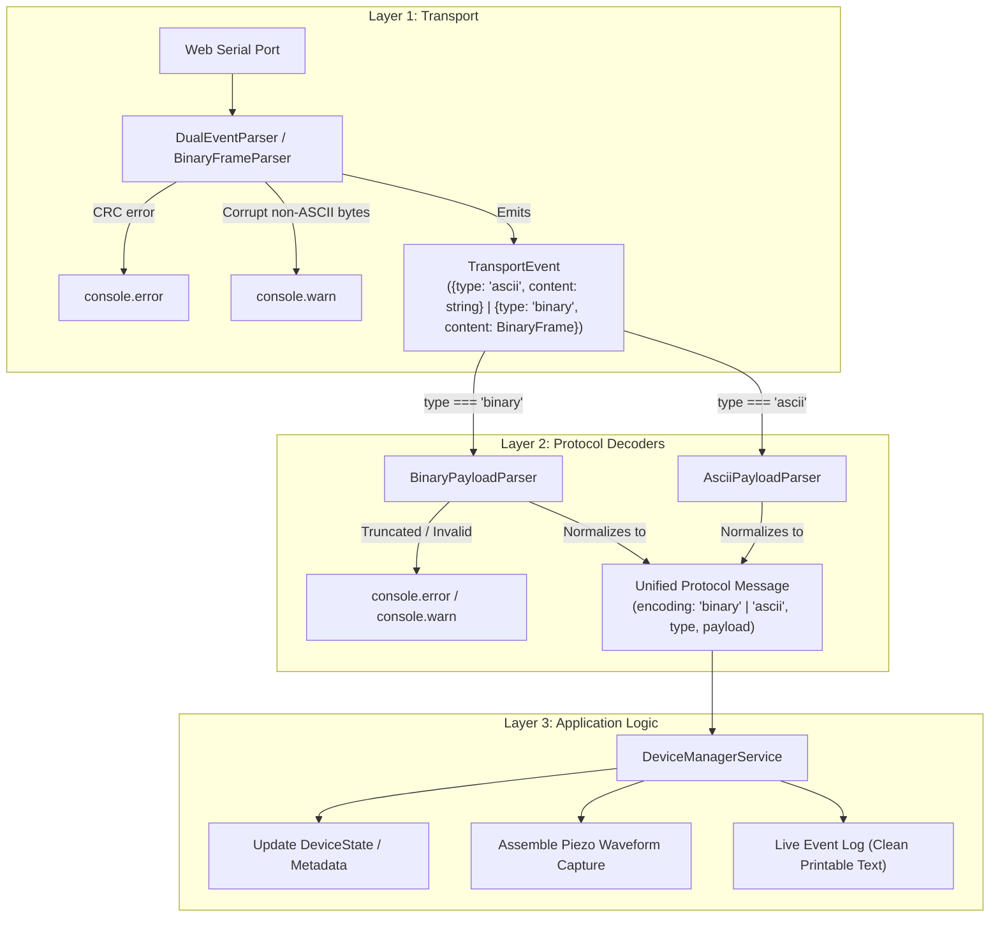

# Web Companion Protocol Architecture

This document describes the 3-tier architecture used in `schlagzaehler-web` to receive, decode, and process both binary TLV frames and fallback ASCII lines from the Schlagzähler firmware.

---

## 3-Tier Architecture Diagram



---

## Architecture Overview

### Layer 1: Transport & Stream Demultiplexing
- **`DualEventParser` / `BinaryFrameParser`**: Consumes incoming raw `Uint8Array` byte chunks from the `WebSerialTransport`.
- Distinguishes binary frames (prefixed by `0xAA55` sync word) from ASCII lines (terminated by `\n`).
- Verifies CRC-16 checksums on binary frames. If a checksum fails, it logs `console.error` and recovers without desyncing.
- Filters corrupt or unprintable bytes preceding sync words, logging `console.warn` instead of passing garbage downstream.
- Emits neutral, discriminated `TransportEvent` objects:
  ```typescript
  export type TransportEvent =
    | { readonly type: 'ascii'; readonly content: string }
    | { readonly type: 'binary'; readonly content: BinaryFrame };
  ```

### Layer 2: Protocol Decoders (Unified Protocol Message Normalization)
- **`BinaryPayloadParser`**: Decodes raw `BinaryFrame` payload byte buffers into strongly typed payloads using DataView with strict length validation. Logs `console.warn` / `console.error` on malformed packets.
- **`AsciiPayloadParser`**: Parses key-value ASCII lines into corresponding typed payloads.
- **Normalization**: After Layer 2, **there is no more difference between ASCII and binary messages**, except for an attribute indicating how the message arrived (`encoding: 'binary' | 'ascii'`). Both streams converge into a single discriminated `UnifiedProtocolMessage` union.

### Layer 3: Application Logic
- **`DeviceManagerService`**: Subscribes to the stream of unified protocol messages.
- Updates authoritative `DeviceState` and `DeviceMetadata` in a single reducer without duplicate branches for ASCII vs. binary.
- Routes waveform chunks (`CAPTURE_START`, `CAPTURE_DATA`, `CAPTURE_END`) directly into the capture builder.
- Formats clean, human-readable representations for the Live Event Log, guaranteeing zero unprintable characters.
